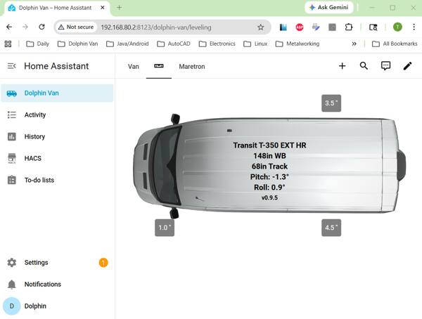

# Integrating with Home Assistant
## Easy Method First
There are two methods for integrating with HomeAssistant.  The easiest is just to embed
the webpage in a HomeAssistant panel using a Webpage Card (i.e., an iframe).  This
provides you with dark mode support, background coloring to show level, and automatic
landscape/portrait orientation support.  The limitations for this method are that you can’t
embed sites using HTTP, like this app, if you are using HTTPS for your Home Assistant, nor can you use
the leveling information in HA automations.

```
views:
  - title: Van Level
    path: van-level
    panel: true
    cards:
      - type: iframe
        url: http://<YOUR-IP-HERE>/    <===== Edit this
        aspect_ratio: 100%
```
This is by far the easiest method.  You only need to edit the IP address and nothing further needs to be done.  It is best if you configure your Van_Level device with a static IP address, or use a DHCP Reservation on your router so that the device address does not change.  You can completely ignore the RESTful API information below.
   
## The Second Method
Since The Van Level app implements a RESTful API server, to integrate with Home Assistant, you need to create a sensor to request data periodically from the REST API, and create a Dashboard card to display that information.

See the HomeAssistant directory for an example YAML package and Lovelace card code. This method
only supports landscape orientation, does not support Dark mode, and will not recolor the
background based on *level*.  This method works with HTTPS based setups, and allows the 
leveling data like wheel lift amounts or `Van OK Level` to be used in automations.

### Edit `configuration.yaml`
The first step is to turn on [packages](https://www.home-assistant.io/docs/configuration/packages/) in Home Assistant. Edit Home Assistant's configuration file `configuration.yaml` located in the `config/` directory.  You need to add the following line to the `homeassistant:` key:
```
    homeassistant:
      packages: !include_dir_named packages
```
You may need to create the directory `packages/` under your Home Assistant's `config/` directory if it doesn't already exist.
### The Van Image
Create the `www/` directory under `config/` if it does not already exist and copy the [van picture](Van_Level_App/Van_Level/HomeAssistant/van_top_view.png) into the `config/www/` directory.
### The REST sensor
Place the [van_leveling.yaml](Van_Level_App/Van_Level/HomeAssistant/van_leveling.yaml) file into the `/config/packages/` directory in Home Assistant.  There is only a single edit to this file needed to customize it to your specific installation. At the top of the file you will see the following:

```
rest:
  - resource: http://YOUR_IP_HERE/readings    <===== Edit this
    method: GET
    scan_interval: 1
    sensor:
      - name: "Van Level Data"
        unique_id: van_level_data
        value_template: "{{ value_json.pitch }}"  # required, even if we only use attributes
        unit_of_measurement: "°"
        # Prevents UI flickering if a network packet drops
        availability: "{{ value_json is defined and value_json.pitch is defined }}"
        json_attributes:
          - pitch
          - roll
          - ver
          - fraction
          - lvl
          - lf
          - rf
          - lr
          - rr
          - vanType
          - wheelbase
          - track
 ```
 Replace the words `YOUR_IP_HERE` with the IP address of your Van Level device.  It is best if you configure your Van_Level device with a static IP address, or use a DHCP Reservation on your router so that the device address does not change.
 
 You can also adjust the `scan_interval` if you desire.  Setting this to a larger value will reduce the traffic on your network, but will also reduce the *responsiveness* of the Dashboard card.
 
 The remaining `template` sensors in the file can be used in Automations as needed.
 
 ### The Dashboard Card
 Copy the contents of [van_leveling_lovelace.yaml](Van_Level_App/Van_Level/HomeAssistant/van_leveling_lovelace.yaml) to your Dashboard. You can add this to the dashboard via the Raw Configuration Editor or through the YAML mode.  I suggest creating a new dashboard tab and adding this all by itself.
 
 
 ### Restarting Home Assistant
 
 Once the necessary changes have all been made, click on [Developer Tools](https://www.home-assistant.io/docs/tools/dev-tools/), select the `YAML` tab and click `CHECK CONFIGURATION`.  If you get a confirmation that the configuration is good, click `RESTART`, and choose restart Home Assistant.
 
 ### Your Van Level Dashboard
 Hopefully, you now have a working Van Level display on your Home Assistant dashboard.
 <br>