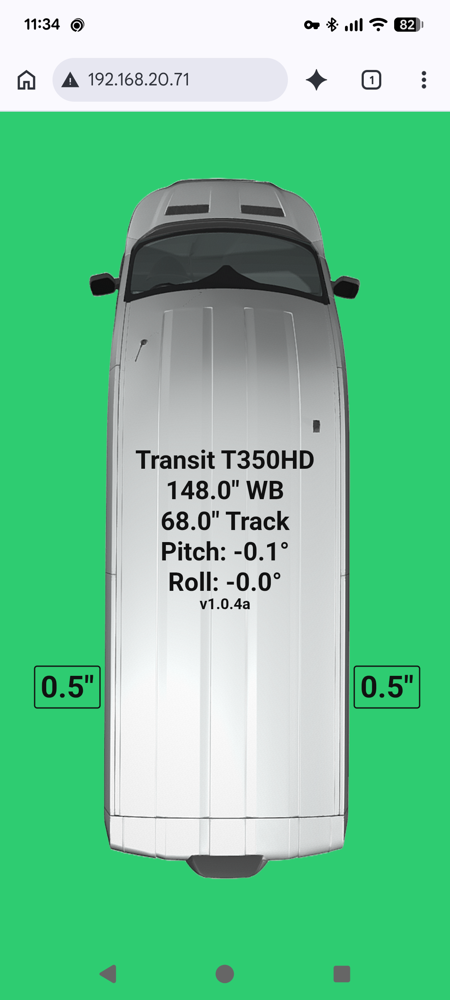
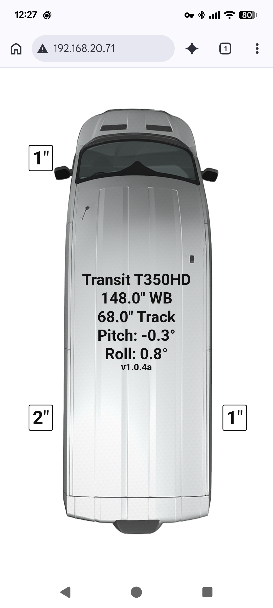
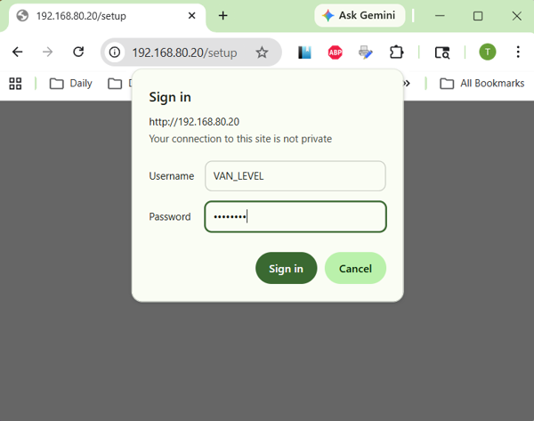
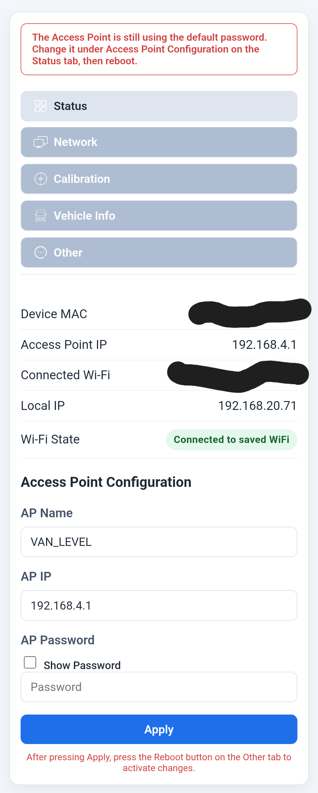
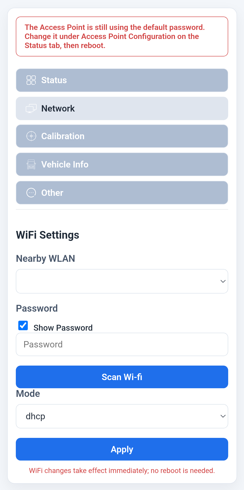
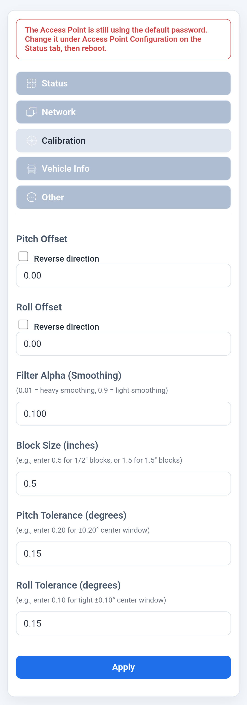
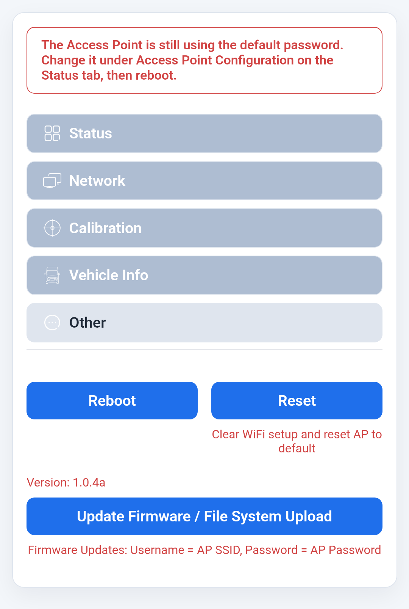
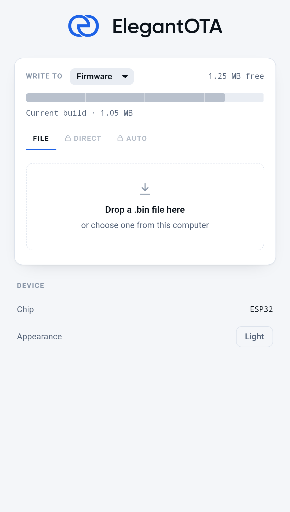

# Van Level

## Overview

ESP32 Based digital level to display leveling information for a camper van. This originally started as an ESPHome application however, the requirement to have Home Assistant running on your phone or tablet in order to see the leveling information was cumbersome.  It was decided that displaying the information on a simple web page, instead of a Home Assistant Lovelace overview, would be much easier to use.  However, there is also a [Home Assistant Dashboard](HOMEASSISTANT.md) setup available.

This app displays a simple webpage with a graphic of a camper van showing the amount of wheel lift (blocking) needed under each tire to level the van.  Included is the *Van Level* app, Kicad PCB files, and Solidworks files to modify a Hammond enclosure to contain the project.

## Product Images



## Project Structure

```
├── CAD Model/                       # SolidWorks 3D model of the board and Hammond enclosure
├── Notes/                           # Datasheets and component references
├── Van_Level_App/Van_Level          # Arduino ESP32 source code
│                 ├── data/          # App's LittleFS website
│                 │   └── images/
│                 └── HomeAssistant/ # RESTful Lovelace card for Home Assistant
├── Van_Level_PCB/                   # Kicad board files
│   └── Component Models/            # STEP files of board components
├── HARDWARE.md                      # Hardware specifications and components
├── HOMEASISTANT.md                  # Integrating with Home Assistant
├── README.md                        # This file
└── SOFTWARE.md                      # Software description
```

## [Hardware](HARDWARE.md)

## [Software](SOFTWARE.md)

## [Home Assistant](HOMEASSISTANT.md)

## Features
This application uses an ESP23 to read acceleration values from an IMU to calculate the pitch and roll angles for a vehicle.  A little trig is used to convert these angles into block heights needed to level the vehicle. The resulting information in presented graphically via a self-hosted webpage and are also made available via a RESTful API resource.

The Wifi supports a standard network client, using either DHCP or static network setup, as well as a local Access Point for connecting directly to the device without a local network.

The leveling information can be viewed using any browser that supports Javascript. The webpage displays an image of a van, and a value next to each wheel requiring blocking.  The rounding of the height values presented can be adjusted to correspond to your leveling block height.  If you have 1" blocks, the rounding value can be set to change in 1" increments.  Additionally, the image background will change to green when the vehicle is level within a user specified range.

The van image can be changed to reflect your particular vehicle model and color, and the vehicle's wheelbase and track measurements can be edited to fit your particular van.  Details on these features are in [Software](SOFTWARE.md).

## Getting Started

### 1. Hardware Setup
1. Connect the ESP32 board to 12V DC power via connector C1 observing correct polarity.
1. Connect to the built-in Access Point by opening your phone or computer Wifi Settings and selecting the `VAN_LEVEL` access point.
1. The default password for the access point is `12345678`.
1. The default name `VAN_LEVEL` and password `12345678` can be changed later.
1. Open the app webpage in any browser by navigating to the hotspot address `192.168.4.1`.
1. Your browser window should look something like this:
<br>

### 2. The Main Display
1. The image above is the standard display in portrait mode.  It will auto rotate for landscape and both views support your browser's `Dark Mode` setting.
1. Next to each wheel location is the number of inches of blocking necessary to level your camper.  If no blocking is needed for a particular wheel, the height for that wheel will be hidden.  The granularity for these values is user selectable (i.e. to match your block height).
1. Centered on the van image, is the status information for your vehicle, including the current pitch and roll values.  If communication with the app is impaired, the status information will flash to indicate aging wheel lift data.  If communication is impaired for a significant amount of time, the status text will flash faster and the wheel lift data will become grayed out.
1. If the pitch and roll values are within user defined tolerances, the background will change to green signifying the van is level.  There is an example of this at the begining of this document.

### 3. AP Configuration
1. To connect the *Van Level* app to your local network, or to change the default access point address, name, and/or password, we need to connect to the configuration page.  Navigate your browser to `192.168.4.1/setup`.
1. You will be asked for a login name and password.  These are the same as the AP name and password initially, and can be easily changed later.
<br>
1. After pressing `Sign in`, your browser should now be displaying the app setup page with the `status` tab selected:
<br>
1. On this page, you can change the Access Point name, IP address, and password.
1. If you make changes to any of the AP settings, after hitting `Apply`, you will need to switch to the `Other` tab and select `Reboot` to enable the changes.
1. The setup page authorization name and password **are the same** as the AP name and password.  If you change the AP name and/or password on this page, remember the values so you can log into the device configuration later.
1. There will be an alert at the top of the page if you are using the default name and/or password.  For security reasons, it is best to change these to something uniquely yours.
1. If you forget your AP name or password, you will no longer be able to log into the `setup` page to make changes.  If this happens, you can reset the App to the original defaults by holding down the 'Boot' button on the ESP32 board for 5 seconds while the device reboots.

### 4. Network Configuration
1. The `Network` tab allows you to connect the *Van Level* app to your local network.  Pressing the `Scan Wi-Fi` button will search for all available access points.  When the scanning is finished, selecting the `Nearby WLAN` dropdown will present a list of all APs found allowing you to select one.
<br>
1. Enter the WiFi password for this network.
1. You can now select DHCP or Static network configuration.  After you have made your selections and filled in the network password, click `Apply`.  Changes are automatic and you do not need to restart the device.
1. You can switch back to the `Status` tab and verify your selected WiFi connection.

### 5. Calibration

1. If the pitch or roll values of your van are not `0` when the van is level, you can enter the opposite amount here to tare the display.  For example, if your van shows +1.0° pitch when level, enter -1.0 in the pitch offset box.
1. Depending on how you mount the Van Level hardware, your pitch and roll values might move in the opposite direction.  Positive pitch should be nose up, and positive roll should be clockwise looking forward (i.e. drivers side higher than the passenger side).  Select `Reverse Direction` if either of your values are opposite of this standard.
1. The `Filter Alpha` setting controls the amount of *dampening* on the pitch and roll readings. I have found a setting of `0.10` seems to be a good compromise between responsiveness and reading jitter.
1. The `Block Size` setting should be set to the smallest block thickness in your stash.  If you have plywood blocks, you might set this to `0.5` [1/2"].  If you use 2 by 12 blocks then you would set this to `1.5` [the nominal thickness of 1.5"].  Many aftermarked plastic block sets are 1" increments.
1. Finally, pitch and roll tolerance is a subjective measure of what you consider *good enough*.  If your vehicle's pitch and roll angles are below these settings, the web page background will turn green signaling *level*.  For reference, on my van with a 148" wheelbase and 68" track, the table below shows various block heights and the corresponding angle values.  I have my tolerances set to slightly less than the 1" block angles since I consider anything less than 1" *good enough*.

    | Block Height (inches) | Pitch Angle Change | Roll Angle Change |
    |----------------------|-------------------|-----------------|
    | 0.25" (1/4) | 0.097° | 0.211° |
    | 0.50" (1/2) | 0.193° | 0.421° |
    | 0.75" (3/4) | 0.290° | 0.631° |
    | **1.00" (1)** | **0.387°** | **0.843°** |
    | 1.25" | 0.483° | 1.052° |
    | 1.50" (1-1/2) | 0.580° | 1.261° |

1. Click the `Apply` button to immediately apply these changes.


### 6. Other

1.  `Reboot` will restart the Van Level device retaining all of your current settings.
1.  `Reset` will clear your stored Wifi network information and restore the default AP captive portal name and password.  **Make sure** this is what you want before pressing `Reset`.  If you have forgotten your AP name and password and can no longer access the configuration page because of this, it is possible to reset the hardware physically.  This process is discussed in [Software](SOFTWARE.md).
1. Selecting `Update Firmware / File System Upload` will allow *Over The Air* updating of the program and webpages.  See [Software](SOFTWARE.md) for more information on this process.
<br>
